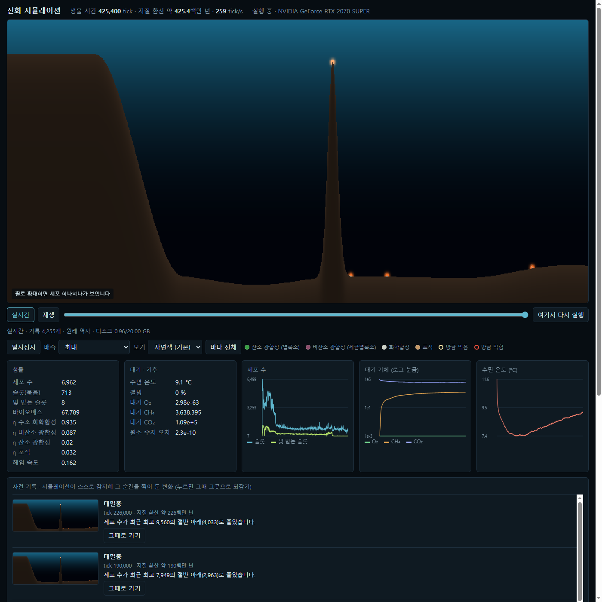
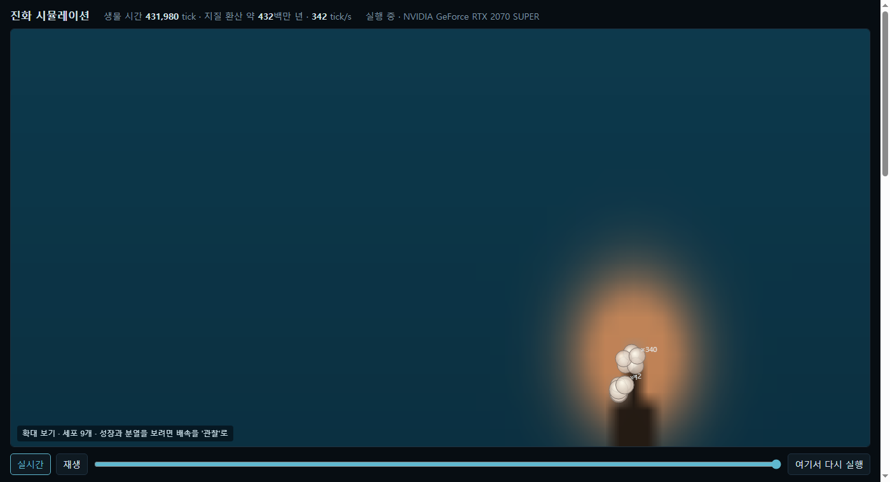

# 진화 시뮬레이션 (Evolution Sim)

지구를 닮은 환경만 주고 배속으로 지켜보는 인공생명 시뮬레이션이다. 시작한 뒤에는 개입하지 않는다.

- 무대는 2D 바다 단면(1,024 × 384칸)이다. 바다 장 8종(수소, 황화물, 산화황, CO₂, 산소, 메탄, 영양염, 사체), 빛, 온도, 해류, 대기·기후가 있다.
- 심해 열수구의 최소 세포 200개에서 출발한다. 생물은 유전자 330개를 가진 세포이고, 실제 화학 에너지(ΔG)로 살며, 분열할 때 돌연변이가 생긴다. 적합도 함수는 없다.
- 각본이 없다. 산소 증가, 빙하기, 대멸종 같은 사건은 물리·화학 규칙과 자연선택에서 저절로 생겨야 한다.
- 원소(C·N·전자)는 장부로 추적한다. 수지 오차는 약 1e-11 수준이다.


*실시간 뷰어(seed 3, 약 4억 2,500만 년 환산). 왼쪽 대륙붕, 가운데 해산 꼭대기와 해저의 주황 점이 열수구다.*

## 각본 없이 나타난 것

| 현상 | 내용 |
|---|---|
| 열수구 적응 | 수소 화학합성 효율 0.5 → 0.94, 최적 온도 30 → 60°C |
| 광합성 출현 | 창시 세포의 광합성 효율은 0이다. 게이트 실행의 절반가량에서 비산소 → 산소 광합성이 저절로 번성했다 |
| 대산화와 메탄 붕괴 | 광합성이 산소를 내놓아 대기 O₂가 쌓이고 메탄 온실이 무너진다 |
| 눈덩이 지구와 해빙 | CO₂가 줄어 전 해양이 얼고(약 −15°C), 얼음 아래에서 화산 CO₂가 쌓여 약 24만 tick 뒤 녹는다. 이후 심해 생존자가 빛으로 돌아와 재번성한다 |
| 층 구조 | 수면 근처 녹색(엽록소) 층, 그 아래 갈자색(세균엽록소) 층 |
| 행동 | 신경망 뇌, 헤엄, 포식 계통, 부착 군체 계통 |
| 다세포 생물체 | 군체가 분화해 마디 사슬 몸을 가진 생물체가 된다. 신경계 단계 게이트 20회 중 5회에서 신경을 가진 생물체가 저절로 나타났다(최대 11마디, 뉴런 178개). 아직 끝까지 남지는 못한다 |
| 화학 감각(주화성) | 먹이 농도가 줄면 방향을 바꾸는 배선(run-and-tumble)이 선택으로 한쪽에 쏠린다. 돌연변이 표류만으로는 양쪽이 비슷하다 |

## 요구 사항

- NVIDIA GPU, 최신 드라이버. CUDA 백엔드를 쓴다. RTX 4050 Laptop과 RTX 2070 SUPER에서 확인했다.
- [uv](https://docs.astral.sh/uv/). uv가 Python 3.12를 알아서 받는다(taichi 1.7.4는 Python 3.13까지만 지원).

## 설치

```bash
powershell -ExecutionPolicy ByPass -c "irm https://astral.sh/uv/install.ps1 | iex"
```

```bash
git clone https://github.com/kasangyong/evolution-sim.git
```

```bash
cd evolution-sim && uv sync --python 3.12
```

## 실시간으로 보기

```bash
uv run python -m evo.main --web 8765 --seed 3
```

브라우저로 http://localhost:8765 를 연다.

| 기능 | 조작 |
|---|---|
| 바다 전체 | 자연색 화면. 물빛은 빛 감쇠, 주황은 열수구 열, 흰 띠는 해빙, 생물은 색소(대사 방식) 농도다 |
| 세포 확대 | 마우스 휠로 확대하면 세포 하나하나가 보인다. 크기, 색소, 헤엄, 분열, 죽음, 포식(밝은 고리 = 먹음, 붉은 테 = 먹힘)이 모두 실제 데이터다. 배속을 "관찰"로 두면 자라는 것이 보인다 |
| 시간 되감기 | 화면 아래 시간 막대를 끈다. "재생", "실시간" |
| 다시 실행 | "여기서 다시 실행"은 그 시점 직전 저장점에서 새 갈래로 진화를 다시 돌린다. GPU 특성상 매번 다른 역사가 된다 |
| 계통수 | 종이 생기고 갈라지고 사라진 역사. 종을 누르면 확대 화면에서 강조한다 |
| 생물체 따라가기 | 다세포 생물체가 생기면 버튼으로 가장 긴 몸을 따라가는 확대 화면 |
| 사건 기록 | 시뮬레이션이 스스로 변화를 감지해 그 순간을 찍어 둔다. "그때로 가기"를 누르면 그 시점·장소로 되감는다 |
| 주소 공유 | `?view=x,y,w`(그 위치를 확대), `?t=tick`(그 시점으로 되감기) |

| 세포 확대 | 사건 기록 |
|---|---|
|  |  |
| 해산 꼭대기 열수구를 확대한 화면. 원 하나가 세포 묶음이고 ×숫자는 묶음 속 세포 수다 | 사건 기록이 "광합성 번성"을 감지하고 자동으로 찍은 확대 화면 |

### 사건 기록

2,000 tick마다 세계를 요약해 아래 변화를 찾는다. 각 감지기는 조건이 확실히 사라져야 다시 켜지므로 같은 사건이 반복 기록되지 않는다.

| 사건 | 조건 |
|---|---|
| 광합성 번성 | 빛 받는 슬롯 > 1,000 |
| 산소 증가 · 메탄 붕괴 | 대기 O₂ > 1,000 · 메탄이 최고치의 10% 아래 |
| 눈덩이 지구 · 해빙 | 결빙 ≥ 99% · 그 뒤 결빙 ≤ 1% |
| 대멸종 | 세포 수가 최근 최고의 절반 아래 |
| 새 능력 확산 | 포식·군체·헤엄·주화성이 일정 비율을 넘음 |
| 새 주요 종 · 주요 종 사라짐 | 두 번 연속 판별에서 전체의 5% 이상 · 두 번 연속 보이지 않음 |

기록은 `runs/history/<실행>/events.jsonl`과 `events/*.png`(바다 전체 + 장소가 있으면 확대)로 남는다.


- 시계는 생물 시간(tick)과 지질 환산(1 tick = 1,000년, 실제 지구 시간 아님)을 함께 보인다.
- 기록은 `runs/history/<시각>-seed<N>/`에 쌓인다. 100 tick마다 화면·세포 기록, 1만 tick마다 전체 저장점. 기본 예산 20 GB(`--budget-gb`)를 넘으면 오래된 과거부터 성기게 줄인다.
- 저장점에서 이어 보기: `uv run python -m evo.main --web 8765 --resume runs/history/<실행>/b0/snaps/<tick>.npz`
- 다른 실행 방법:
  - 데스크톱 창 뷰어: `uv run python -m evo.main`
  - UI 없이 N tick: `uv run python -m evo.main --headless 20000`

## 원리

```
한 tick = 열수구 분출 → 수송(확산·해류·침강) → 비생물 화학 → 기체 교환 → 기후(온실·결빙·풍화·화산·태양)
        → 빛·온도 → 생물: 이동 → 칸 집계 → 뇌 → 포식 → 대사 → 사망 → 분열
```

- 생물의 에너지는 반응의 ΔG에서만 나온다(효율 η < 1, 공짜 에너지 없음). 유지비가 있어 모든 능력을 가진 세포는 불리하다.
- 슬롯 하나가 같은 유전체의 세포 묶음(슈퍼개체)을 나타낼 수 있다. 개체 풀(131,072 슬롯)이 차도 계통이 슬롯 추첨으로 사라지지 않게 하기 위해서다.
- 자세한 설계: [docs/design/evolution-sim-arch.md](docs/design/evolution-sim-arch.md). 에이전트 인수인계: [CLAUDE.md](CLAUDE.md).

## 진행 상황

| 단계 | 내용 | 결과 문서 |
|---|---|---|
| 1 | 환경(장, 수송, 열수구, 대기·기후, 원소 수지) | [stage1](docs/design/stage1-results.md) |
| 2 | 최소 생명(개체 풀, 수소 화학합성, 분열·돌연변이) | [stage2](docs/design/stage2-results.md) |
| 3a | 대사(광합성 2종, 호기 호흡, 황·메탄 대사, 산소 독성) | [stage3a](docs/design/stage3a-results.md) |
| 3b | 행동(신경망 뇌, 헤엄, 포식) | [stage3b](docs/design/stage3b-results.md) |
| 4 | 화산, 실시간 화면, 시간 기계, 종·계통수 | [stage4](docs/design/stage4-results.md) |
| 5·6 | 24시간 실행, 태양 광도 증가, 군체, 최종 판정 | [stage6](docs/design/stage6-results.md) |
| 7a | 화학 감각(주화성, 감각 적응), 사건 기록 | [stage7a](docs/design/stage7a-results.md) |
| 7b | 다세포 몸(마디·조직 분화·근육과 섬모 헤엄·생식 세포·조각남) | [stage7b](docs/design/stage7b-results.md) |
| 7c | 신경계(뉴런 유형 유전자로 회로가 자람, 연속 전위 뉴런, 고유 감각으로 헤엄 파동, 뇌 보기) | [stage7c](docs/design/stage7c-results.md) |
| 7d | 살면서 배우기(도파민 같은 조절 신호의 3요소 학습, 습관화, 덧붙이기 발생, 배운 것 저장) | [stage7d](docs/design/stage7d-results.md) |

각 단계는 평가 에이전트가 "통과"를 낸 뒤에 다음으로 넘어갔다.

| 성공 기준 | 내용 | 현재 |
|---|---|---|
| S1 | CPU 단일 스레드 같은 seed → 같은 상태 | 테스트 통과 |
| S2 | 5만 마리 ≥ 200 tick/s | 412~426 (기록 켜면 번성 상태 약 230) |
| S3 | 24시간 무사고, 메모리 증가 < 5% | 검증 중 |
| S4 | 10 seed × 2회 × 10만 tick 중 ≥ 8 존속 | 20/20 |
| S4' | 100만 tick 3회 중 ≥ 2 존속 | 3/3 |
| S5 | 화학합성 외 에너지 전략의 각본 없는 출현 | 통과(광합성, 포식) |
| S6 | 원소 수지 오차 < 0.1% | 약 1e-11 (장기 실행 1e-7 이하) |

## 테스트

```bash
uv run pytest -q
```

```bash
uv run ruff check evo tests scripts
```

## 검증 스크립트 (`PYTHONPATH=.` 필요)

| 스크립트 | 용도 |
|---|---|
| `scripts/stage1_check.py [--seeded]` | 10만 tick 수지·발산 검사 |
| `scripts/survival_run.py <seed> [ticks]` | 생존 1회 실행 |
| `scripts/s4_gate.py [name]` | 10 seed × 2회 생존 게이트. `runs/<name>.log`, 중단돼도 이어서 돈다 |
| `scripts/s4p_runs.py [log=NAME] [seed ...]` | 100만 tick 장기 생존(S4') |
| `scripts/s3_monitor.py [port] [every_s] [hours]` | 실행 중인 뷰어의 메모리·tick·오차 감시(S3) |
| `scripts/bench_life.py <warmup> [key=val ...] [--profile]` | 성능 측정(S2) |
| `scripts/check_cuda_consistency.py` | GPU 원자 연산 경합 상태의 개체 풀·수지 불변식 |
| `scripts/timeline.py <seed> <ticks> <every>` | 빛 받는/어두운 개체, 기후, 표층 화학 시간표 |
| `scripts/boom_check.py <seed>` | 광합성 번성을 유도해 심해 군집 유지 확인(검사 전용) |
| `scripts/behaviour_check.py <seed> <ticks>` | 뇌 출력(사냥)과 포식 유전자의 관계 |
| `scripts/organism_check.py <seed> [ticks] [every] [plan] [sect.key=val]` | 손으로 만든 생물체로 생활사 확인(검사 전용) |
| `scripts/taxis_check.py <gate name ...>` | 실행 사이 주화성 비교(대조 감각 포함) |
| `scripts/bench_snapshot.py <snapshot>` | 저장점(예: 번성 상태)에서 속도 측정 |

## 알려진 한계

- 육지가 없는 2D 바다 단면이다. 능력은 유전자 목록 안에서만 진화한다.
- 사건이 지구보다 빠르다(순서는 같다). 1 tick = 1,000년은 지질 사건에 맞춘 압축이다.
- "다시 실행"은 같은 역사를 재현하지 않는다(난수 상태 미저장, GPU 비결정성).
- 기록을 켜면 처리량이 약 절반이 된다.
